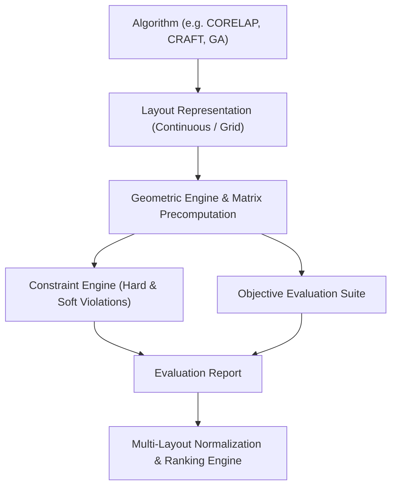

# Evaluation & Constraint Methodology
## Mathematical Formulations & Objective Framework

### 1. Architectural Philosophy: Decoupled Evaluation

In classical operations research software, algorithms often compute and report their own scores. In FLODSS, **algorithms are strictly decoupled from scoring**. 

Every layout—regardless of whether it was generated by a constructive heuristic, an improvement algorithm, an exact MILP model, or manual input—is subjected to the identical evaluation pipeline:
1. **Geometric Validation**: Verifies boundary containment, non-overlap, aspect ratios, and fixed anchors.
2. **Matrix Precomputation**: Caches $N \times N$ deterministic distance, flow, and relationship matrices.
3. **Constraint Engine**: Categorizes violations into HARD (feasibility killer) and SOFT (penalty cost).
4. **Objective Functions**: Calculates quantitative Material Handling Cost, qualitative Closeness Satisfaction, and Floor Space Utilization.
5. **Ranking Engine**: Applies multi-criteria normalization with **feasibility-first prioritization**.

---

### 2. Distance Metrics

Given two departments $i$ and $j$ with centroids $(x_i, y_i)$ and $(x_j, y_j)$:

#### 2.1 Rectilinear (Manhattan / $L_1$) Distance
Standard for factories with orthogonal aisle grids:
$$D_{ij}^{L_1} = |x_i - x_j| + |y_i - y_j|$$

#### 2.2 Euclidean ($L_2$) Distance
Standard for overhead cranes, automated aerial shuttles, or conveyor systems:
$$D_{ij}^{L_2} = \sqrt{(x_i - x_j)^2 + (y_i - y_j)^2}$$

---

### 3. Quantitative Material Handling Metrics

#### 3.1 Directed Flow-Distance ($FD$)
Measures total transportation distance volume. Flow is strictly directed ($i \to j \neq j \to i$):
$$FD = \sum_{i \in \mathcal{D}} \sum_{j \in \mathcal{D}, j \neq i} F_{ij} \times D_{ij}$$
Where:
- $F_{ij}$: Material volume/trips moving from department $i$ to department $j$.
- $D_{ij}$: Distance between centroids under the selected metric.

#### 3.2 Material Handling Cost ($MHC$)
Incorporates differential transport equipment costs (e.g., AGV vs. Forklift vs. Manual cart):
$$MHC = \sum_{i \in \mathcal{D}} \sum_{j \in \mathcal{D}, j \neq i} F_{ij} \times D_{ij} \times C_{ij}$$
Where:
- $C_{ij}$: Cost per unit flow per unit distance.
- If $C_{ij}$ is omitted or zero on a specific flow, FLODSS defaults to `default_cost_per_unit_distance` (configurable, default: 1.0).

---

### 4. Qualitative Relationship Satisfaction (Muther's SLP)

Muther's Systematic Layout Planning (SLP) defines closeness affinities using vowel ratings:

| Rating | Definition | Standard Numerical Weight ($W_r$) | Proximity Goal |
| :---: | :--- | :---: | :--- |
| **A** | Absolutely Necessary | **+16** | Minimize Distance |
| **E** | Especially Important | **+8** | Minimize Distance |
| **I** | Important | **+4** | Minimize Distance |
| **O** | Ordinary Closeness | **+2** | Moderate Distance |
| **U** | Unimportant | **0** | Neutral |
| **X** | Undesirable (Separation Required) | **-8** | Maximize Distance |

Let $D_{\max} = \sqrt{W_{\text{facility}}^2 + H_{\text{facility}}^2}$ be the maximum possible facility distance.

#### 4.1 Positive Relationship Reward ($W_{ij} > 0$)
Departments with positive closeness ratings earn higher scores when placed closer together:
$$S_{ij} = W_{ij} \times \left(1.0 - \frac{D_{ij}}{D_{\max}}\right)$$

#### 4.2 Negative Relationship Penalty ($W_{ij} < 0$, rating 'X')
Departments with safety hazards, noise, or contamination must be kept apart. Closeness incurs a heavy penalty:
$$S_{ij} = |W_{ij}| \times \left(\frac{D_{ij}}{D_{\max}} - 1.0\right)$$
If they are placed right next to each other ($D_{ij} \approx 0$), $S_{ij} = -|W_{ij}|$. If kept at maximum separation ($D_{ij} \approx D_{\max}$), penalty approaches 0.

#### 4.3 Total Relationship Score & Normalized Satisfaction
$$\text{RawScore} = \sum_{(i,j) \in \mathcal{R}} S_{ij}$$
$$\text{MaxPossibleScore} = \sum_{(i,j) \in \mathcal{R}, W_{ij} > 0} W_{ij}$$
$$\text{Satisfaction Ratio (\%)} = \max\left(0, \min\left(100, \frac{\text{RawScore}}{\text{MaxPossibleScore}} \times 100\right)\right)$$

---

### 5. Floor Area Utilization

Evaluates spatial efficiency without double-counting reserved or dead zones:
- Total Facility Gross Area: $A_{\text{facility}} = W_{\text{facility}} \times H_{\text{facility}}$
- Occupied Department Area: $A_{\text{dept}} = \sum_{d \in \mathcal{D}} (w_d \times h_d)$
- Reserved / Restricted Area: $A_{\text{reserved}} = \sum_{z \in \mathcal{Z}} (w_z \times h_z)$
- Net Usable Area: $A_{\text{usable}} = \max\left(0, A_{\text{facility}} - A_{\text{reserved}}\right)$

$$\text{Utilization Ratio (\%)} = \left(\frac{A_{\text{dept}}}{A_{\text{facility}}}\right) \times 100$$
$$\text{Net Usable Utilization (\%)} = \left(\frac{A_{\text{dept}}}{A_{\text{usable}}}\right) \times 100$$

---

### 6. Constraint Classification & Feasibility

Constraints are divided into two distinct classes:

#### 6.1 Hard Constraints (Feasibility Gate)
Any violation of a HARD constraint renders the layout **strictly infeasible**:
$$\text{IsFeasible} = \left(\sum \text{HardViolations} == 0\right)$$
- `non_overlapping`: Department intersection area $> \epsilon$.
- `boundary`: Protrusion beyond facility perimeter $[0, W] \times [0, H]$.
- `fixed_position`: Deviation of department origin or centroid from prescribed anchor coordinates.
- Hard operational minimum/maximum distances.

#### 6.2 Soft Constraints (Penalty Function)
Soft constraints represent industrial preferences or secondary operating guidelines. They do not invalidate the layout but add an additive penalty cost:
$$\text{PenaltyCost} = \sum_{k \in \mathcal{C}_{\text{soft}}} \text{Magnitude}_k \times \text{UnitPenalty}_k$$
- Soft minimum distance violation: $\Delta = \max(0, d_{\min} - D_{ij})$
- Soft maximum distance violation: $\Delta = \max(0, D_{ij} - d_{\max})$
- Soft adjacency violation: Departments expected to share a boundary wall do not touch.
- Soft separation violation: Incompatible departments placed closer than safety clearance.

---

### 7. Multi-Layout Comparison & Normalization

When comparing multiple alternative layouts $\mathcal{S} = \{s_1, s_2, \dots, s_m\}$:

#### 7.1 Objective Directions
- **Minimize**: Material Handling Cost ($MHC$), Flow Distance ($FD$), Soft Penalty ($P$).
- **Maximize**: Relationship Satisfaction ($Rel$), Area Utilization ($Util$).

#### 7.2 Min-Max Normalization
For a minimization objective $k \in \{MHC, FD, P\}$:
$$N_k(s) = \frac{\max_{s' \in \mathcal{S}} V_k(s') - V_k(s)}{\max_{s' \in \mathcal{S}} V_k(s') - \min_{s' \in \mathcal{S}} V_k(s')}$$

For a maximization objective $k \in \{Rel, Util\}$:
$$N_k(s) = \frac{V_k(s) - \min_{s' \in \mathcal{S}} V_k(s')}{\max_{s' \in \mathcal{S}} V_k(s') - \min_{s' \in \mathcal{S}} V_k(s')}$$

If all layouts have identical values for an objective ($\max = \min$), $N_k(s) = 1.0$.

#### 7.3 Composite Score
Given user-defined or default weights $w_k$:
$$\text{CompositeScore}(s) = \frac{\sum_{k} w_k \times N_k(s)}{\sum_{k} w_k} \in [0.0, 1.0]$$

#### 7.4 Feasibility-First Ranking Rule
Solutions are ordered by the following strict lexicographical criteria:
1. **Feasibility**: All feasible layouts ($IsFeasible = \text{True}$) precede all infeasible layouts.
2. **Feasible Partition**: Sorted descending by `CompositeScore` (higher score is better).
3. **Infeasible Partition**: Sorted ascending by:
   - Number of Hard Violations (fewer violations rank better),
   - Total Soft Penalty (lower penalty ranks better),
   - Composite Score descending.

---

### 8. Machine-Readable Diagnostics for AI Explainability

The Evaluation Report produces structured top contributors breakdowns:
- **Top Flow Contributors**: The specific $(i, j)$ pairs driving the highest percentage of Material Handling Cost.
- **Top Relationship Deficits**: The specific $(i, j)$ pairs failing SLP closeness goals.
- **Granular Violation Table**: Constraint ID, classification, measured vs. required values, and violation magnitudes.

This structure allows LLMs (e.g., Gemini Advisor) to deliver precise engineering advice:
> *"Department ASSEMBLY and SHIPPING generate 38.3% of total transport cost due to a 50m separation. Consider swapping SHIPPING with MACHINING to reduce overall material handling by $2,400/year."*
