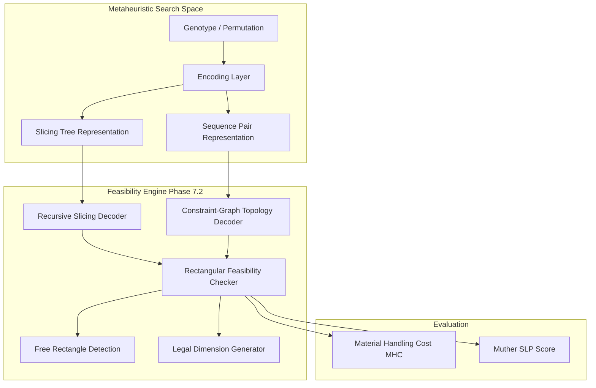

# Rectangular Layout Feasibility Foundation

## 1. Executive Summary & Purpose

In classical Facility Layout Optimization (FLP) literature, heuristic and construction algorithms often work on discrete grid abstractions (such as ALDEP's serpentine strip sweeps or CORELAP's unit-cell expansions). When converting these solutions into physical, constructible factory plans, significant geometric anomalies arise:
- Departments wrap across strip boundaries forming L-shapes, T-shapes, or disconnected blocks.
- Bounding-box projections artificially expand departments, causing massive pairwise overlaps even when discrete grid cells are completely disjoint.
- Department cross-sectional areas become distorted by up to 100% or more.
- Algorithmic results cannot be fairly evaluated against clean manual engineering baselines.

**Phase 7.2** establishes an algorithm-independent, mathematically rigorous **Rectangular Layout Feasibility Foundation**. It provides standardized tools for legal shape generation, empty space discovery, feasibility verification, ALDEP conversion diagnostics, and architectural representations for future metaheuristics.

---

## 2. Mathematical Formulation & Feasibility Rules

Let a facility plant be defined on continuous 2D Euclidean space:
$$\mathcal{F} = [0, W_{\text{plant}}] \times [0, H_{\text{plant}}] \subset \mathbb{R}^2$$

For each department $i \in \{1, \dots, N\}$, a rectangular placement is characterized by the tuple:
$$\mathcal{P}_i = (x_i, y_i, w_i, h_i)$$
where $(x_i, y_i)$ is the bottom-left coordinate, $w_i > 0$ is the width along the X-axis, and $h_i > 0$ is the height along the Y-axis.

A placement set $\{\mathcal{P}_1, \dots, \mathcal{P}_N\}$ is **strictly feasible** if and only if all eight conditions hold simultaneously:

### 1. Exact Area Conservation
For required area $A_i^{\text{req}}$ and tolerance $\epsilon_{\text{area}} = 10^{-4}$:
$$|w_i \cdot h_i - A_i^{\text{req}}| \le \epsilon_{\text{area}}$$

### 2. Dimensional Range Limits
For specified department bounds $[W_i^{\min}, W_i^{\max}]$ and $[H_i^{\min}, H_i^{\max}]$:
$$W_i^{\min} \le w_i \le W_i^{\max}$$
$$H_i^{\min} \le h_i \le H_i^{\max}$$

### 3. Aspect Ratio Bounding
Defining the aspect ratio $\lambda_i = \frac{\max(w_i, h_i)}{\min(w_i, h_i)} \ge 1.0$:
$$\lambda_i \le \lambda_i^{\max}$$
where $\lambda_i^{\max}$ prevents physically unconstructible narrow corridors.

### 4. Plant Boundary Containment
The bounding box of department $i$ must reside entirely within the plant:
$$0 \le x_i \quad \text{and} \quad x_i + w_i \le W_{\text{plant}}$$
$$0 \le y_i \quad \text{and} \quad y_i + h_i \le H_{\text{plant}}$$

### 5. Pairwise Non-Overlap
For any pair of distinct departments $i \ne j$:
$$\operatorname{Area}\left(\mathcal{P}_i \cap \mathcal{P}_j\right) = \max\left(0, \min(x_i + w_i, x_j + w_j) - \max(x_i, x_j)\right) \cdot \max\left(0, \min(y_i + h_i, y_j + h_j) - \max(y_i, y_j)\right) \le \epsilon_{\text{geom}}$$
where $\epsilon_{\text{geom}} = 10^{-4}\,\text{m}^2$.

### 6. Fixed Position Constraints
If department $i$ has a predetermined coordinate $(x_i^{\text{fix}}, y_i^{\text{fix}})$:
$$x_i = x_i^{\text{fix}} \quad \text{and} \quad y_i = y_i^{\text{fix}}$$

### 7. Reserved Zone Avoidance
For any static architectural obstacle or reserved corridor $\mathcal{R}_k$:
$$\operatorname{Area}\left(\mathcal{P}_i \cap \mathcal{R}_k\right) = 0$$

### 8. Completeness
All $N$ departments defined in the problem specification must be placed:
$$\operatorname{Placed}(\mathcal{F}) = \{1, \dots, N\}$$

---

## 3. Geometric Failure Modes in Classical ALDEP & Grid Conversions

The benchmark results in Phase 7.1 revealed why ALDEP consistently produced 0% feasible continuous layouts on `FLP_INDUSTRIAL_10`. Our diagnostic module (`ALDEPGeometryDiagnostics`) isolates the specific failure modes:

### A. Discrete Non-Rectangular Cell Clusters (`DISCRETE_NON_RECTANGULAR_CELLS`)
In ALDEP, departments are laid down by strip-sweep filling along columns or rows. When a department's area requires more cells than remain in a vertical strip, it wraps into the adjacent strip (serpentine curve). 
- Discrete cell count $|S_i| < (r_{\max} - r_{\min} + 1) \times (c_{\max} - c_{\min} + 1)$.
- The resulting cluster is an L-shape, U-shape, or fragmented stair-step.

### B. Bounding-Box Overlap vs. Grid Cell Disjointness (`BOUNDING_BOX_OVERLAP`)
When two L-shaped departments interlock on a discrete grid, their grid cell sets $S_A \cap S_B = \emptyset$ are 100% disjoint. However, computing the continuous minimum bounding boxes $B_A$ and $B_B$ produces overlapping rectangles:
$$\operatorname{Area}(B_A \cap B_B) > 0$$
Converting grid solutions to continuous rectangular representations by naive bounding box wrapping creates artificial overlaps that violate physical feasibility.

### C. Area Distortion (`AREA_DISTORTION`)
A non-rectangular cluster of cells wrapped in a continuous bounding box has an allocated bounding-box area strictly larger than the department's required area:
$$\text{Distortion Ratio} = \frac{\operatorname{Area}(B_i)}{A_i^{\text{req}}} > 1.0$$
In dense factory layouts such as `FLP_INDUSTRIAL_10`, this distortion expands departments beyond available space, pushing them into neighbor departments and across exterior plant walls.

---

## 4. Maximal Empty Rectangle (MER) Detection

To safely place rectangular departments or evaluate residual free capacity, the system employs **Maximal Empty Rectangles** (`FreeRectangleDetector`).

### Algorithm Mechanics
1. **Orthogonal Coordinate Decomposition:** 
   Collect all vertical boundary lines $\{x_0=0, x_k, x_{k}+w_k, W_{\text{plant}}\}$ and horizontal boundary lines $\{y_0=0, y_k, y_k+h_k, H_{\text{plant}}\}$ from the facility, placed departments, and reserved zones.
2. **Interval Discretization:**
   Project these coordinates into elementary atomic cells $([x_a, x_{a+1}] \times [y_b, y_{b+1}])$ marked as either `Occupied` or `Empty`.
3. **2D Sweep Expansion:**
   For every possible combination of horizontal intervals $[y_{b1}, y_{b2}]$, find the maximum contiguous span of empty intervals $[x_{a1}, x_{a2}]$ that can be expanded in both directions without hitting an obstacle or boundary.
4. **Pruning & Maximality:**
   Filter out sub-rectangles contained within larger rectangles to produce the set of **Maximal Empty Rectangles (MERs)**.

### Why MERs Overlap
Maximal Empty Rectangles can overlap each other. Consider an L-shaped free space in a $50 \times 20$ facility with a $10 \times 10$ block in the corner:
- Candidate Region $R_1$: Width 40, Height 20 (Area = 800 m²)
- Candidate Region $R_2$: Width 50, Height 10 (Area = 500 m²)

Both are maximal because neither can be expanded without hitting the corner block or plant walls. They overlap across $[10..50] \times [10..20]$ (Area = 400 m²). 
$$\sum \operatorname{Area}(\text{MER}_k) = 800 + 500 = 1300 > \text{Net Free Area} (900)$$
Each MER represents an **alternative maximal rectangular placement opportunity**, not a disjoint partitioning of free space.

---

## 5. Legal Dimension Generator

The `LegalDimensionGenerator` computes mathematically feasible rectangular shapes conserving exact area:

### Simultaneous Bound Formulation
Given required area $A$ and limits $W_{\min}, W_{\max}, H_{\min}, H_{\max}, \lambda_{\max}$:
1. From height limits: $h \in [H_{\min}, H_{\max}] \implies w \in [A / H_{\max}, A / H_{\min}]$.
2. From aspect ratio limits: $\lambda = \max(w, h)/\min(w, h) \le \lambda_{\max} \implies w \in [\sqrt{A / \lambda_{\max}}, \sqrt{A \cdot \lambda_{\max}}]$.
3. Combined feasible width interval:
   $$W_{\text{lower}} = \max\left(W_{\min}, \frac{A}{H_{\max}}, \sqrt{\frac{A}{\lambda_{\max}}}\right)$$
   $$W_{\text{upper}} = \min\left(W_{\max}, \frac{A}{H_{\min}}, \sqrt{A \cdot \lambda_{\max}}\right)$$

If $W_{\text{lower}} > W_{\text{upper}}$, no rectangular shape can simultaneously satisfy the constraints, and an empty candidate list is returned.

### Generated Candidate Archetypes
- **Square-ish:** $w = \sqrt{A}$ clamped to $[W_{\text{lower}}, W_{\text{upper}}]$.
- **Min/Max Width Extrems:** $w = W_{\text{lower}}$ and $w = W_{\text{upper}}$.
- **Min/Max Height Extrems:** $w = A / H_{\text{clamped}}$.
- **Aspect Ratio Bounds:** $w = \sqrt{A / \lambda_{\max}}$ and $w = \sqrt{A \cdot \lambda_{\max}}$.
- **Modular Alignments:** Snapping to existing widths or heights of previously placed departments to encourage clean architectural alignment.
- **Interpolated Variants:** Uniformly spaced legal alternatives across $[W_{\text{lower}}, W_{\text{upper}}]$.

---

## 6. Preparation for Phase 8 Metaheuristics

Phase 7.2 intentionally provides the architectural foundation for upcoming global optimization metaheuristics (Genetic Algorithm, Simulated Annealing, NSGA-II).

### Representation Comparison

| Property | Naive Free Coordinates $(x, y, w, h)$ | Discrete Grid (ALDEP style) | Slicing Tree (Normalized Polish Expr) | Sequence Pair $(\Gamma^+, \Gamma^-)$ |
| :--- | :--- | :--- | :--- | :--- |
| **Overlap Probability** | High (frequent overlaps during crossover/mutation) | Zero on grid; High on continuous bbox conversion | **0% Guaranteed** (Slicing cuts bisect non-overlapping space) | **0% Guaranteed** (Topological precedence DAG enforces non-overlap) |
| **Shape Guarantees** | Can drift / skew without penalties | Non-rectangular serpentine clusters | **100% Strict Rectangles** | **100% Strict Rectangles** |
| **Plant Boundary** | Frequently violates plant edges | Enclosed by grid matrix | **100% Guaranteed** (Bounded by root facility rectangle) | Compact packing guarantees boundary fit |
| **Search Space Completeness** | Continuous, infinite, heavily infeasible | Combinatorial grid permutations | Slicing layouts (covers all Guillotine-cut layouts) | Non-slicing and slicing layouts (complete orthogonal topology) |
| **Repair Overhead** | Massive complex constraint repairs | Complex contour smoothing needed | **Zero Repair Needed** | **Zero Repair Needed** |

### Academic Recommendation for Phase 8
1. **Slicing Tree / Normalized Polish Expression:**
   Ideal for construction and genetic optimization of factory plants where guillotine cuts align naturally with production aisles and logistics corridors.
2. **Sequence Pair Representation:**
   Ideal for dense multi-department facilities with unequal department dimensions and reserved zones.
3. **Legal Dimension Generator Integration:**
   Allows the metaheuristic chromosome to choose both topological ordering and a discrete legal shape gene index from the pre-generated legal dimension catalog.
