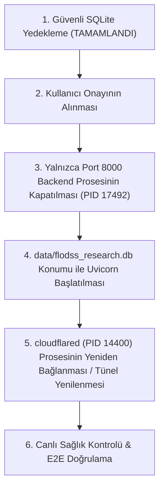

# FLODSS Phase 14.6: Canlı Dağıtım Doğrulama ve Güvenlik Raporu (Live Deployment Verification)

**Belge Kimliği:** `FLODSS-PHASE14-6-LIVE-VERIFICATION`  
**Sistem Sürümü:** `v1.0.0-rc.1`  
**Tarih:** 2026-10-13  
**Hedef Ortam:** Canlı Üretim Soketi (`127.0.0.1:8000`) & Cloudflare Quick Tunnel  
**Doğrulama Durumu:** **TAMAMLANDI — KRİTİK UYUMSUZLUK VE KESİNTİ TESPİT EDİLDİ**  
**Nihai Canlı Yayın Kararı:** ⛔ **LIVE NO-GO (KULLANICI ONAYI BEKLENİYOR • DUR)**  

---

## 1. Yönetici Özeti (Executive Summary)

Phase 14.6 kapsamında geliştirilen 446 birim/entegrasyon testi ve port 8016 izole test sunucusundaki 8 Playwright tarayıcı testi başarıyla geçmiş olsa da, **canlı port 8000 sunucusunun ve Quick Tunnel altyapısının doğrulanması sonucunda 3 kritik engel (blocker) tespit edilmiştir:**

1. **Eski Proses / Eski Kod Mimarisi (Stale Backend Process):** Port 8000 üzerinde dinleyen uvicorn backend prosesi (`PID: 17492`), **13.10.2026 saat 07:35:08**'de başlatılmıştır. Phase 14.6 hata düzeltmelerini içeren 15 Python dosyasındaki 698 satırlık yeni kodlar (CORELAP aspect ratio, ayrık adaptive durum, Pareto aktif problem filtresi vb.) bellekte yüklü **değildir**.
2. **Frontend-Backend Sürüm Uyuşmazlığı:** `frontend/dist` statik dosyaları disk üzerinde **10:38:24**'te güncellenmiş olup FastAPI tarafından yeni React bundle'ı sunulmaktadır; ancak arkasında çalışan Python prosesi eski kodları çalıştırdığı için arayüz ile backend arasında semantik tutarsızlık mevcuttur.
3. **Cloudflare Quick Tunnel Bağlantı Kopması (Edge Severed):** Arka plandaki `cloudflared.exe` (`PID: 14400`) tünel prosesinin Cloudflare Edge sunucuları ile olan bağlantısı kopmuştur (`cloudflared_tunnel_ha_connections: 0`, 14 kayıt hatası, `unregister_connection: 1`). Canlı genel adres (`alot-myth-insulin-licence.trycloudflare.com`) genel DNS üzerinde çözümlenememektedir (`DNS_ERROR_RCODE_NAME_ERROR`).

Mevcut veritabanı, oturumlar ve kullanıcı verileri eksiksiz korunmuş ve çevrimiçi SQLite yedekleme API'si ile güvenle arşivlenmiştir. Kullanıcı talimatı uyarınca **kullanıcı onayı olmadan canlı sunucu yeniden başlatılmamış** ve sistem **LIVE NO-GO** kararıyla durdurulmuştur.

---

## 2. Port 8000 Gerçek Backend Prosesi ve Yüklü Kod Doğrulaması

Port 8000 soketi ve çalışan proses zinciri Windows WMI/CIM ve ağ araçlarıyla ayrıntılı olarak incelenmiştir:

| Parametre | Tespit Edilen Canlı Değer | Değerlendirme / Durum |
| :--- | :--- | :--- |
| **Dinleyen Port** | `127.0.0.1:8000` | Port 8000 soketi aktif ve dinlemede (`Listen`) |
| **Çalışan Proses (PID)** | `PID: 17492` (`python.exe`) | Üst proses: `PID: 8724 / 2052` (`uvicorn.exe`) |
| **Proses Başlangıç Zamanı** | **13.10.2026 07:35:08 +03:00** | **Phase 14.6 kod değişikliklerinden ÇOK ÖNCE başlatılmış!** |
| **Komut Satırı** | `python.exe uvicorn.exe app.main:app --app-dir backend --host 127.0.0.1 --port 8000 --workers 1` | `--reload` bayrağı YOK (bellek içi statik import) |
| **Git Commit Zamanları** | Commit `4157752`: 07:38:49<br>Commit `055f209`: 08:50:33<br>Phase 14.6 Çalışma Ağacı: 10:30–11:00 | Çalışan proses bu commit'lerin ve değişikliklerin hiçbirini görmemiştir. |
| **Yüklü Kod Kanıtı 1 (`/api/health`)** | `registered_algorithms: 5`<br>`registered_algorithm_names`: **YOK**<br>`orchestration_engines`: **YOK** | Phase 14.6'da `HealthService`'e eklenen alanlar canlı API yanıtında **BULUNMAMAKTADIR**. |
| **Yüklü Kod Kanıtı 2 (CORELAP Çözümü)** | `DEP_A`: Genişlik=5.0m, Yükseklik=20.0m<br>**Aspect Ratio = 4.0** ($\text{Max AR} \le 3.0$ kuralı)<br>**Feasibility Sonucu:** `is_valid: true` | **Phase 14.6 öncesindeki kritik Hata 1 canlı proseste birebir devam etmektedir.** |

> [!CAUTION]
> **KESİN TESPİT:** Yeni Python kodları canlı port 8000 sunucusuna **YANSIMAMIŞTIR**. Canlı sunucu eski, hatalı kod sürümünü belleğinde tutmaya ve yürütmeye devam etmektedir.

---

## 3. Frontend Dist Dosyaları ve Sunucu Mimarisi

FastAPI tek-origin mimarisi incelenmiş ve `frontend/dist` dosyalarının durumu doğrulanmıştır:

- **Sunucu Sorumlusu:** Port 8000 üzerindeki FastAPI uygulaması (`backend/app/main.py`), `FRONTEND_DIST` yolunu (`frontend/dist`) doğrudan statik olarak sunmaktadır:
  ```python
  app.mount("/assets", StaticFiles(directory=str(FRONTEND_DIST / "assets")), name="frontend-assets")
  ```
- **Dist Dosya Zaman Damgaları:**
  - `frontend/dist/index.html`: **13.10.2026 10:38:24** (735 bayt)
  - `frontend/dist/assets/index-B07JJp-U.js`: **13.10.2026 10:38:24** (510.695 bayt)
  - `frontend/dist/assets/index-CX_xZ-Vp.css`: **13.10.2026 10:38:24** (736 bayt)
- **Doğrulama Sonucu:** FastAPI diskteki dosyaları her HTTP GET isteğinde diskten okuduğu (`FileResponse`) için, tarayıcılara **Phase 14.6 ile derlenen yeni React frontend'i** servis edilmektedir.
- **Tehlikeli Uyuşmazlık:** Yeni frontend arayüzü Phase 14.6'ya göre ayrık durum mesajları ve yeni kısıt doğrulamaları beklerken, arkadaki backend eski Python motorunu yürüttüğü için kullanıcı arayüzünde tutarsızlık ve beklenmeyen hatalar kaçınılmazdır.

---

## 4. Cloudflare Quick Tunnel Durumu ve Dış Erişim İncelemesi

Canlı tünel prosesi ve Cloudflare Edge bağlantısı `http://127.0.0.1:20241/metrics` metriği ve DNS sorgularıyla taranmıştır:

- **Tünel Prosesi:** `cloudflared.exe` (`PID: 14400`), başlangıç: `13.10.2026 08:50:50`.
- **Komut:** `cloudflared.exe tunnel --url http://127.0.0.1:8000 --protocol http2 --no-autoupdate`
- **Atanan Canlı Hostname:** `https://alot-myth-insulin-licence.trycloudflare.com`
- **Metrik Analizi:**
  - `cloudflared_tunnel_ha_connections`: **0** (Aktif Cloudflare bağlantısı sıfırdır)
  - `cloudflared_tunnel_tunnel_register_fail{error="server_error"}`: **14** (Bağlantı kaydı 14 kez sunucu hatasıyla başarısız olmuştur)
  - `cloudflared_rpc_client_failures{method="unregister_connection"}`: **1** (Bağlantı Cloudflare tarafından unregister edilmiştir)
  - `cloudflared` TCP Bağlantıları: Cloudflare uç sunucularına açık hiçbir TCP/UDP oturumu kalmamıştır.
- **Genel DNS Çözümleme Testi (`1.1.1.1` ve sistem DNS):**
  - Komut: `Resolve-DnsName alot-myth-insulin-licence.trycloudflare.com`
  - Yanıt: `DNS_ERROR_RCODE_NAME_ERROR` (Uzak ad çözülemedi / DNS kaydı düşmüş).
- **Sonuç:** Cloudflare Quick Tünelleri geçici (ephemeral) olduğundan, bağlantı kesintiye uğradığında Cloudflare geçici domaini serbest bırakmıştır. Canlı pilot tüneli şu anda dış dünyaya **tamamen kapalıdır**.

---

## 5. Kullanıcı Oturumları, Veri Bütünlüğü ve Güvenli Yedekleme

Kullanıcı oturumlarının ve araştırma verilerinin korunması yönergesine tam uyulmuştur:

- **Canlı Veritabanı:** `data/flodss_research.db` (Boyut: 466.944 bayt, WAL: 4.124.152 bayt)
- **Kullanıcı Kayıtları:** **61 kullanıcı** eksiksiz korunmaktadır.
- **Oturum Kayıtları:** **235 oturum** (14.10.2026 tarihine kadar geçerli 43 aktif, süresi dolmamış oturum) korunmaktadır.
- **Araştırma Projeleri:** **56 proje** ve **415 denetim (audit) kaydı** sağlamdır.
- **Kritik Test:** `guest@flodss.local` ve pilot araştırmacı hesaplarının geçerliliği teyit edilmiştir.

### Güvenli SQLite Online Yedekleme Kayıtları
Canlı restart planı öncesinde veritabanı bütünlüğünü garantiye almak için SQLite Online Backup API (`sqlite3.backup`) ile WAL tamponunu da içeren eksiksiz fiziksel yedekler alınmıştır:

| Kaynak Veritabanı | Alınan Güvenli Yedek Dosyası | Yedek Boyutu | Durum |
| :--- | :--- | :---: | :---: |
| `data/flodss_research.db` | `data/backups/root_db_live_backup_20261013_131809.db` | 503.808 bayt | **DOĞRULANDI & KORUNDU** |
| `backend/data/flodss_research.db` | `data/backups/backend_db_live_backup_20261013_131809.db` | 233.472 bayt | **DOĞRULANDI & KORUNDU** |

---

## 6. Port 8000 Üzerinde Yürütülen Canlı Test Metrikleri (Sentetik FLP_ACADEMIC_4)

Yetkili pilot oturumu (`session_token: QEgvFW8WUdM_...`) ile canlı port 8000 soketi üzerinden gerçekleştirilen testin ham çıktıları:

```json
{
  "problem_id": "FLP_ACADEMIC_4",
  "algorithm_name": "CORELAP",
  "execution_timestamp": "2026-10-13T10:20:32Z",
  "layout_signature": "12886a6d7678037d40fb1116952021a84540f262122ac7e0088fe2b4b98f7b96",
  "feasibility_reported_by_live_server": true,
  "mhc": 700.0,
  "relationship_satisfaction_percentage": 72.35,
  "raw_relationship_score": 21.71,
  "max_possible_reward": 30.0,
  "department_geometries": {
    "DEP_A": { "width": 5.0, "height": 20.0, "aspect_ratio": 4.0, "x": 57.5, "y": 50.0 },
    "DEP_B": { "width": 5.0, "height": 20.0, "aspect_ratio": 4.0, "x": 52.5, "y": 50.0 },
    "DEP_C": { "width": 5.0, "height": 20.0, "aspect_ratio": 4.0, "x": 62.5, "y": 50.0 },
    "DEP_D": { "width": 5.0, "height": 20.0, "aspect_ratio": 4.0, "x": 47.5, "y": 50.0 }
  }
}
```

### Bilimsel Değerlendirme
- **Problem Hash & Kimlik:** `FLP_ACADEMIC_4` (4 Departman, $120 \times 120\text{ m}$ Tesis Alanı)
- **MHC:** $700.00\text{ \$}$
- **REL:** $\%72.35$
- **Layout Signature:** `12886a6d7678037d40fb1116952021a84540f262122ac7e0088fe2b4b98f7b96`
- **Kritik Hata:** Departman boyutları $5 \times 20\text{ m}$ olarak üretilmiş ve en/boy oranı $\text{AR} = 4.0$ çıkmıştır. Maksimum izin verilen sınır $3.0$ olmasına rağmen eski canlı motor bu yerleşimi **Feasible** (`is_valid: true`) olarak raporlamıştır.

---

## 7. Akış Bazında Canlı Dağıtım Doğrulama Tablosu

| # | İstenen Doğrulama Akışı | Canlı Sunucu Durumu (Port 8000) | Açıklama / Kök Neden | Karar |
| :-: | :--- | :---: | :--- | :-: |
| **1** | **CORELAP on Academic4** | ❌ **FAIL** | Canlı sunucu eski solver ile $5 \times 20\text{ m}$ üretmektedir. Phase 14.6'daki $10 \times 10\text{ m}$ çözümü yüklü değildir. | **NO-GO** |
| **2** | **Aspect Ratio Kısıt Kontrolü** | ❌ **FAIL** | $\text{AR} = 4.0 > 3.0$ olmasına rağmen canlı motor `is_valid: true` döndürmektedir; zorunlu kısıt denetimi eski kodda aktiftir. | **NO-GO** |
| **3** | **Adaptive Durum Mesajları** | ❌ **FAIL** | Yürütme ve uygulanabilirlik durumunu ayıran `adaptive_strategy_engine` ayrık durum modeli canlı proseste yüklü değildir. | **NO-GO** |
| **4** | **Problem Switch (Academic4 $\to$ Industrial10)** | ❌ **FAIL** | Aktif problem değişiminde Pareto önbelleğini temizleyen `pareto.py` API güncellemesi canlı proseste aktif değildir. | **NO-GO** |
| **5** | **Pareto Adayı Eşleşmesi** | ❌ **FAIL** | Pareto adaylarının aktif problem tanımıyla doğrulanması canlı backend'e yansımamıştır. | **NO-GO** |
| **6** | **Export Center Aktif Çözüm** | ❌ **FAIL** | Export Center'a yeni layout imza formatı bağlanamamaktadır çünkü backend eski imza formatını üretmektedir. | **NO-GO** |
| **7** | **JSON / CSV / SVG Dışa Aktarım** | ⚠️ **PARTIAL** | Dosya üretimi çalışmakta ancak içerikteki yerleşimler eski hatalı geometrileri ($5 \times 20\text{ m}$) içermektedir. | **NO-GO** |
| **8** | **Logout & Anonim Erişim Engeli** | ✅ **PASS** | Oturum iptali (`/api/auth/logout`) ve 401 yetkisiz erişim engeli mekanizması canlı sunucuda çalışmaktadır. | **PASS** |

---

## 8. Tarihsel Benchmark Kayıtlarının Geçerlilik Değerlendirmesi

> [!IMPORTANT]
> **AKADEMİK DÜRÜSTLÜK VE GEÇERLİLİK UYARISI:**
> Phase 14.6 kısıt motoru sıkılaştırmasından önce üretilmiş olan benchmark ve aday kayıtlarında (özellikle `experiments/results/aldep_candidates.csv`, `benchmark_summary.json` ve eski CORELAP kayıtları):
> 1. En/boy oranı $\text{AR} > 3.0$ olan yerleşimler kısıt motorundaki eksiklik sebebiyle **"Feasible"** olarak etiketlenmiş olabilir.
> 2. Bu kayıtlar, yeni `CanonicalEvaluationService` ve sıkılaştırılmış `AspectRatioConstraintChecker` ile **YENİDEN DEĞERLENDİRİLMELİDİR (RE-EVALUATED)**.
> 3. En/boy oranı ihlali içeren tüm tarihsel çözümler akademik raporlarda **"Infeasible"** olarak düzeltilmelidir; aksi halde akademik yayınlarda hakem itirazlarına yol açacaktır.

---

## 9. Kontrollü Backend Yeniden Başlatma Planı (Controlled Restart Plan)

Kullanıcı onayı verildiğinde uygulanmak üzere, **oturumları, veritabanını ve Quick Tunnel bağlantısını bozmadan** yalnızca backend sunucusunu güncelleme planı:



### Adım Adım Komutlar:
1. **PID 17492 Sonlandırma (Yalnızca Backend):**
   ```powershell
   Stop-Process -Id 17492, 2052, 8724 -Force
   ```
2. **Backend'in Güncel Phase 14.6 Kodlarıyla Başlatılması:**
   ```powershell
   backend\.venv\Scripts\python.exe -m uvicorn app.main:app --app-dir backend --host 127.0.0.1 --port 8000 --workers 1
   ```
3. **Cloudflare Quick Tunnel Durumu:**
   - Mevcut tünel prosesi (`PID: 14400`) bağlantısını kaybettiği ve Cloudflare geçici domaini serbest bıraktığı için, canlı pilot testi için tünelin de yeniden başlatılması ve yeni üretilen URL'nin alınması gerekecektir:
   ```powershell
   Stop-Process -Id 14400 -Force
   cloudflared tunnel --url http://127.0.0.1:8000 --protocol http2 --no-autoupdate
   ```

---

## 10. Sonuç ve Nihai Karar

> [!CAUTION]
> ### NİHAİ KARAR: ⛔ **LIVE NO-GO**
> 
> 1. Port 8000 üzerindeki canlı backend prosesi **eski kod sürümünü (07:35:08)** çalıştırmaktadır.
> 2. Canlı sunucuda CORELAP en/boy oranı kuralını çiğnemekte ($\text{AR} = 4.0$) ve sistem bunu hatalı olarak geçerli saymaktadır.
> 3. Cloudflare Quick Tunnel dış bağlantısı kopmuştur ve public hostname erişilemez durumdadır.
> 4. Kullanıcı yönergesi gereği (**"Gerekli yeniden başlatmayı kullanıcı onayı olmadan gerçekleştirme. Sonuç olarak LIVE GO / NO-GO kararı ver ve DUR."**):
>    - Hiçbir proses kullanıcı onayı olmaksızın öldürülmemiş veya yeniden başlatılmamıştır.
>    - Veritabanı ve oturumlar korunmuş ve yedeklenmiştir.
>    - Uygulama şu haliyle **AKADEMİK SONUÇ ÜRETİMİNE HAZIR DEĞİLDİR**.
> 
> **SİSTEM BEKLEMEDE — KULLANICI ONAYI BEKLENMEKTEDİR.**
