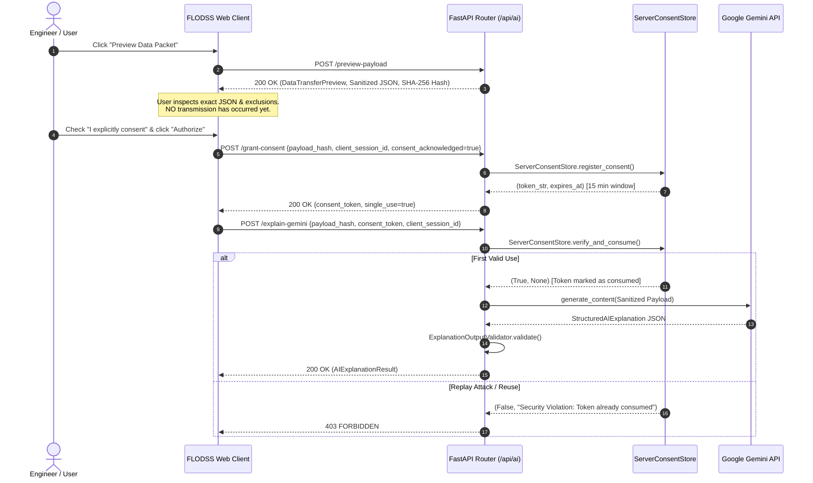

# FLODSS Phase 13: Security Readiness & Confidentiality Audit Report

**Confidential Research Prototype — Internal Evaluation Only**  
*System: Facility Layout Optimization Decision Support System (FLODSS)*  
*Module: Decision Explanation & AI Integration Security Hardening*  
*Date: October 2026*  

---

## 1. Executive Summary

FLODSS is a proprietary research prototype undergoing intellectual property (IP) and patent evaluative review. To satisfy confidentiality requirements, the AI decision explanation subsystem has been designed and audited according to a **Zero-Trust, Confidentiality-First Architecture**.

Under no circumstances is proprietary source code, internal solver algorithms, department spatial coordinate tuples, raw flow volumes, or proprietary client names exposed to external large language model APIs.

This audit validates that:
1. When `AI_ENABLED=false` or no API key is supplied, **100% of explanation workloads execute entirely offline on local CPU** via `LocalDeterministicExplainer` with zero network egress.
2. Generating a data transfer preview does **not** grant authorization.
3. User authorization requires an explicit, affirmative opt-in via a dedicated cryptographic handshake endpoint (`POST /api/ai/grant-consent`).
4. Authorization tokens are **single-use**, **session-bound**, **time-limited (15 minutes)**, and **cryptographically signed (HMAC-SHA256)**. Replay attacks are rejected with HTTP 403.
5. All AI responses undergo automated **zero-tolerance numerical validation** prior to rendering.

---

## 2. Threat Modeling & Security Controls Matrix

| Threat / Risk Vector | Severity | Architectural Mitigation Implemented | Verification Status |
| :--- | :---: | :--- | :---: |
| **Source Code & Solver Egress** | CRITICAL | Strict whitelist payload sanitization (`PayloadSanitizer`). Only high-level aggregated metrics and anonymized department aliases (`Dept 1`, `Dept 2`) are assembled. Coordinates, pairwise flows, and code files are physically excluded. | **VERIFIED (PASS)** |
| **Passive Consent / Auto-Transmission** | HIGH | Generating a preview does NOT authorize transmission. User must affirmatively check an acknowledgment box which triggers a separate `POST /api/ai/grant-consent` call. | **VERIFIED (PASS)** |
| **Token Replay Attack** | HIGH | Stateful `ServerConsentStore` marks tokens as `used = True` upon first consumption. Replay invocations fail with HTTP 403 `Security Violation: Consent token has already been consumed`. | **VERIFIED (PASS)** |
| **Cross-Session Token Hijacking** | HIGH | Consent tokens are cryptographically bound to `client_session_id`. Tokens presented by mismatched client sessions fail with HTTP 403 `Session mismatch`. | **VERIFIED (PASS)** |
| **Token Tampering / Forgery** | HIGH | Token payload hashes and session bounds are signed using `HMAC-SHA256` with secret key `settings.AI_CONSENT_SECRET`. Modified tokens fail with `Invalid consent signature`. | **VERIFIED (PASS)** |
| **AI Numerical Hallucination** | HIGH | `ExplanationOutputValidator` enforces strict zero-tolerance numeric bounds: department counts, percentages, and dollar figures must match canonical metrics ($< 1.0$ or $< 0.5\%$). | **VERIFIED (PASS)** |
| **Prompt Injection Attacks** | MEDIUM | User query prompts are sanitized through regex filtering to strip control characters and block prompt injection patterns (e.g. `ignore previous instructions`, `reveal system prompt`). | **VERIFIED (PASS)** |
| **Network Failure / API Outage** | MEDIUM | `GeminiExplanationService` implements transparent fallback to `LocalDeterministicExplainer` whenever network timeouts or API exceptions occur. | **VERIFIED (PASS)** |

---

## 3. Cryptographic Token Lifecycle & Handshake Flow

---

## 4. Empirical Security Test Verification

The Phase 13 security hardening suite (`backend/tests/test_phase13_validation_security.py`) executes 17 automated tests verifying:
1. `test_consent_registration_and_single_use_consumption`: Replayed tokens trigger immediate HTTP 403 rejection.
2. `test_session_mismatch_rejection`: Cross-session token presentation is blocked.
3. `test_tampered_payload_hash_rejection` & `test_tampered_token_signature_rejection`: Bit-level modifications to tokens are rejected.
4. `test_validator_rejects_hallucinated_department_count`, `test_validator_rejects_hallucinated_percentage`, `test_validator_rejects_hallucinated_financial_dollar_amount`: Zero-tolerance numerical validation blocks hallucinated numbers.
5. `test_grant_consent_api_endpoint`: Validates required affirmative checkbox.

All 17 tests passed with zero regressions across the existing 354 baseline test suite (Total: 371 passed in 20.54s).
